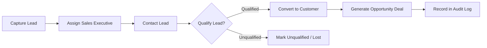
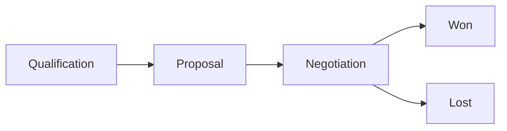
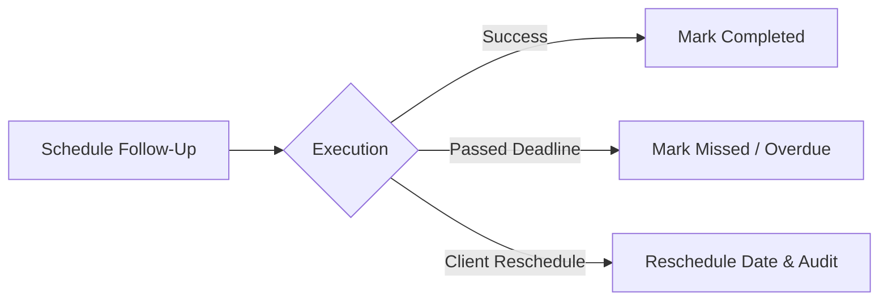

# AcxiomCRM — Enterprise Customer Relationship Management System

[](https://dotnet.microsoft.com/)
[](https://dotnet.microsoft.com/apps/aspnet)
[](https://docs.microsoft.com/ef/core/)
[](https://www.microsoft.com/sql-server)
[](https://getbootstrap.com/)
[](#)

> **AcxiomCRM** is a web-based, role-governed Customer Relationship Management (CRM) application designed for sales organizations. It manages the entire customer-sales lifecycle from lead capture, qualification, and follow-up to sales pipeline, opportunity management, activity tracking, audit logging, and reporting.

---

## 📑 Table of Contents

- [1. Project Overview & Business Scenario](#1-project-overview--business-scenario)
- [2. Technology Stack & Architecture](#2-technology-stack--architecture)
- [3. Complete Module Structure](#3-complete-module-structure)
- [4. Role-Based Authorization & Permission Matrix](#4-role-based-authorization--permission-matrix)
- [5. Core CRM Workflows](#5-core-crm-workflows)
- [6. Multi-Level Validation Specification](#6-multi-level-validation-specification)
- [7. Core Data Entities & Database Design](#7-core-data-entities--database-design)
- [8. Security & Authentication Architecture](#8-security--authentication-architecture)
- [9. REST API Specification](#9-rest-api-specification)
- [10. Reporting & Dashboard Analytics](#10-reporting--dashboard-analytics)
- [11. Testing & Acceptance Scenarios](#11-testing--acceptance-scenarios)
- [12. Getting Started & Setup Guide](#12-getting-started--setup-guide)

---

## 1. Project Overview & Business Scenario

AcxiomCRM provides an enterprise platform for sales teams, managers, and administrators:
- **Sales Executives** manage their assigned leads, customer relationships, follow-up reminders, and opportunity deals.
- **Sales Managers** monitor team performance, oversee aggregate pipelines, track conversion ratios, and inspect business reports.
- **System Administrators** administer users and roles, oversee system configuration, monitor audit trails, and maintain data integrity.

### Assignment Completion Standard
> **Note**: A submission is not considered complete if it is only a database CRUD application. The application demonstrates end-to-end CRM workflows, client-side validation, server-side validation, business rules, secure authentication, role-based authorization, dashboard analytics, audit logging, REST API endpoints, and a structured layered architecture.

---

## 2. Technology Stack & Architecture

### Tech Stack
| Component | Technology |
| :--- | :--- |
| **Framework** | ASP.NET Core 10.0 MVC (Model-View-Controller) |
| **Data Access & ORM** | Entity Framework Core 10.0 (Code-First with Migrations) |
| **Relational Database** | Microsoft SQL Server / LocalDB |
| **Security & Identity** | ASP.NET Core Identity (PBKDF2 Password Hashing, Claims, Lockout) |
| **Frontend & UI** | Razor Views, Bootstrap 5, Custom Responsive Styles, FontAwesome |
| **Client Validation** | jQuery Validation & jQuery Unobtrusive Validation |
| **Data Visualization** | Chart.js for interactive dashboard pipeline and status graphs |
| **API Architecture** | RESTful Controllers with strongly typed DTOs |

### Layered Architecture

```text
                       ┌─────────────────────────┐
                       │          Users          │
                       └────────────┬────────────┘
                                    │
                       ┌────────────▼────────────┐
                       │   Presentation Layer    │ Razor Views, ViewModels, Bootstrap 5,
                       │                         │ Client-Side Validation, Chart.js
                       └────────────┬────────────┘
                                    │
                       ┌────────────▼────────────┐
                       │    Application Layer    │ Controllers, DTOs, Service Coordination,
                       │                         │ Workflow Orchestration
                       └────────────┬────────────┘
                                    │
                       ┌────────────▼────────────┐
                       │ Domain / Business Layer │ Entities, Status Transitions, Business Rules,
                       │                         │ Authorization Checks
                       └────────────┬────────────┘
                                    │
                       ┌────────────▼────────────┐
                       │   Data Access Layer     │ ApplicationDbContext, EF Core Repositories,
                       │                         │ Transaction Handling
                       └────────────┬────────────┘
                                    │
                       ┌────────────▼────────────┐
                       │     Database Layer      │ SQL Server (Constraints, Indexes, FKs)
                       └─────────────────────────┘
        ════════════════════════════════════════════════════════════════
             Cross-Cutting: Security + Audit Logging + Validation
```

---

## 3. Complete Module Structure

```text
AcxiomCRM
│
├── 🔐 Authentication & Access Control
│   ├── Login (with Lockout & Antiforgery protection)
│   ├── User Registration / Account Provisioning
│   ├── Logout (Session termination)
│   └── Role & Permission Enforcement
│
├── 📊 Dashboard & Analytics
│   ├── KPI Cards (Total Customers, Leads, Open/Won/Lost Opportunities, Pipeline Value)
│   ├── Chart.js Visualizations (Lead Status, Opportunity Pipeline, Monthly Sales)
│   └── Role-Scoped Visibility
│
├── 👥 Customer Management
│   ├── Customer Directory (Search, Filter, Pagination)
│   ├── Create, View Details, Edit, Deactivate
│   ├── Unique Email and Phone Validation
│   └── Customer History & Related Interactions
│
├── 🎯 Lead Management
│   ├── Lead Capture (Source, Expected Value, Priority)
│   ├── Assignment to Sales Executives
│   ├── Status Workflow (New ➔ Contacted ➔ Qualified ➔ Unqualified / Converted / Lost)
│   └── Lead Conversion to Customer & Opportunity
│
├── 💼 Opportunity Management
│   ├── Deal Tracking (Amount, Stage, Probability %, Expected Close Date)
│   ├── Pipeline Stages (Qualification, Proposal, Negotiation, Won, Lost)
│   ├── Weighted Pipeline Calculation (Amount × Probability / 100)
│   └── Active Deal Date & Value Rules
│
├── 📅 Follow-Up Management
│   ├── Follow-Up Scheduling against Customers, Leads, and Opportunities
│   ├── Lifecycle Statuses (Planned, Completed, Missed, Cancelled)
│   ├── Upcoming & Overdue Activity Dashboards
│   └── Date Rules (No past dates for new planned entries)
│
├── 📞 Activity Management
│   ├── Calls, Meetings, Emails, and Tasks
│   └── Activity history linked to Leads and Customers
│
├── 🛡️ User & Role Management
│   ├── Admin User Administration & Role Assignment
│   ├── Account Activation / Deactivation & Lockout Management
│   └── Password Reset Handling
│
├── 📝 Audit Log
│   ├── Append-only event history (User, Action, Entity, RecordId, Diff, Timestamp, IP)
│   └── Audited operations (Logins, Failures, Create, Update, Delete, Role Changes)
│
├── 🌐 REST API
│   ├── Secured endpoints for Customers, Leads, Opportunities, and Follow-ups
│   └── DTO request/response mapping with proper HTTP status codes
│
└── 📈 Reports
    ├── Customer, Lead Conversion, Opportunity, and Pipeline Reports
    └── User Activity and Audit Reports with filtering and export readiness
```

---

## 4. Role-Based Authorization & Permission Matrix

The application enforces server-side Role-Based Access Control (RBAC) across three primary roles:

| Module | Administrator (Admin) | Sales Manager | Sales Executive |
| :--- | :---: | :---: | :---: |
| **Dashboard** | Full enterprise-wide KPIs | Team pipeline & team metrics | Own assigned metrics & leads |
| **Customers** | Full (CRUD, all records) | Full team/business scope | Own/assigned customers |
| **Leads** | Full (CRUD & assignment) | Team leads & assignment | Own assigned leads |
| **Opportunities** | Full (All deals & stages) | Team pipeline management | Own assigned opportunities |
| **Follow-Ups** | Full access | Team follow-ups oversight | Own scheduled follow-ups |
| **Activities** | Full access | Team activity tracking | Own logged activities |
| **User Management** | Full (Create, edit, lock/unlock) | View-only / Team scope | No access |
| **Role Management** | Full access | No access | No access |
| **Audit Logs** | Full audit inspection | Limited / department view | No access |
| **Reports** | All reports & audit exports | Management & pipeline reports | Own performance reports |
| **REST API** | Authorized administrative endpoints | Authorized team endpoints | Authorized personal endpoints |

---

## 5. Core CRM Workflows

### 1. Lead-to-Customer Conversion


### 2. Opportunity Pipeline Progression

- **Weighted Pipeline Calculation**: `Weighted Value = (Amount × Probability) / 100`

### 3. Follow-Up Lifecycle


---

## 6. Multi-Level Validation Specification

AcxiomCRM implements a dual-layer validation model: client-side for immediate user experience and server-side to guarantee integrity against bypass or tampering.

### Validation Matrix
| Field / Area | Validation Category | Rule & Acceptance Criteria |
| :--- | :--- | :--- |
| **Customer Name** | Required + Length | Mandatory; max string length enforced. |
| **Customer Email** | Format + Uniqueness | Valid email pattern; uniqueness checked in database. |
| **Customer Phone** | Format + Uniqueness | Valid phone format/length; uniqueness checked in database. |
| **Duplicate Prevention** | Business Rule | Duplicate customer records with identical identifiers are rejected. |
| **Lead Status** | Workflow Rule | Must be one of `New`, `Contacted`, `Qualified`, `Unqualified`, `Converted`, `Lost`. |
| **Lead Expected Value** | Numeric Range | Positive numeric value within configured boundary. |
| **Opportunity Amount** | Numeric + Business | Cannot be negative; active opportunities require `Amount > 0`. |
| **Probability** | Numeric + Business | Must be between `0` and `100` inclusive. |
| **Expected Close Date** | Business Validation | Cannot be in the past for active opportunities. |
| **Follow-Up Date** | Business Validation | Cannot be earlier than current date (`>= Today`) for new/planned follow-ups. |
| **CSRF Token** | Security Validation | All state-changing POST forms must validate antiforgery tokens. |

---

## 7. Core Data Entities & Database Design

### Mandatory Relational Entities
```text
┌─────────────────┐       ┌─────────────────┐       ┌─────────────────┐
│    Customer     │◄──────┤   Opportunity   │──────►│      User       │
├─────────────────┤ 1   * ├─────────────────┤ *   1 ├─────────────────┤
│ CustomerId (PK) │       │OpportunityId(PK)│       │ Id (PK)         │
│ CustomerCode    │       │ OpportunityName │       │ UserName        │
│ CustomerName    │       │ Amount          │       │ Email           │
│ Email (Unique)  │       │ Stage           │       │ PasswordHash    │
│ Phone (Unique)  │       │ Probability     │       │ LockoutEnd      │
│ CompanyName     │       │ ExpectedCloseDate│      │ IsActive        │
│ Address, City   │       │ CustomerId (FK) │       └────────┬────────┘
│ CreatedDate     │       │ LeadId (FK)     │                │
│ CreatedBy       │       │ AssignedTo (FK) │                │
└────────┬────────┘       └─────────────────┘                │
         │ 1                       1                         │ 1
         │                         │                         │
         │ *                       │ *                       │ *
┌────────┴────────┐       ┌────────┴────────┐       ┌────────┴────────┐
│    FollowUp     │       │    Activity     │       │    AuditLog     │
├─────────────────┤       ├─────────────────┤       ├─────────────────┤
│ FollowUpId (PK) │       │ ActivityId (PK) │       │ AuditLogId (PK) │
│ FollowUpDate    │       │ ActivityType    │       │ UserId          │
│ FollowUpType    │       │ Subject         │       │ Action          │
│ Remarks         │       │ Description     │       │ EntityName      │
│ Status          │       │ ActivityDate    │       │ RecordId        │
│ CustomerId (FK) │       │ CustomerId (FK) │       │ OldValue        │
│ LeadId (FK)     │       │ LeadId (FK)     │       │ NewValue        │
│ AssignedTo (FK) │       │ AssignedTo (FK) │       │ IpAddress       │
└─────────────────┘       └─────────────────┘       │ CreatedDate     │
                                                    └─────────────────┘
```

---

## 8. Security & Authentication Architecture

- **ASP.NET Core Identity**: Secure membership system managing credentials, identity cookies, claims, and role grants.
- **Adaptive Password Hashing**: PBKDF2 with HMAC-SHA256 and cryptographic salts. Plaintext passwords are never stored or logged.
- **Password Complexity Policy**: Minimum 8 characters with required uppercase, lowercase, numbers, and special symbols.
- **Account Lockout Protection**: Automatic account lockout triggered upon repeated failed login attempts for a configurable duration.
- **Anti-Forgery Defense**: `[ValidateAntiForgeryToken]` enforced on all state-changing MVC HTTP POST actions.
- **SQL Injection Prevention**: Parameterized queries and LINQ expressions via Entity Framework Core.
- **Safe Auditing**: Sensitive values (passwords, tokens, credentials) are excluded from logs and audit records.

---

## 9. REST API Specification

All REST endpoints require authentication and role-scoped permissions, returning standard DTO models and semantic HTTP status codes.

| Method | Endpoint | Description | Permitted Access |
| :--- | :--- | :--- | :--- |
| `POST` | `/api/auth/login` | Authenticate API client and return token/session | Public / Rate-limited |
| `POST` | `/api/auth/logout` | Invalidate token/terminate session | Authenticated |
| `GET` | `/api/customers` | List and search customers | Authorized users |
| `GET` | `/api/customers/{id}` | Retrieve customer record by ID | Authorized users |
| `POST` | `/api/customers` | Create a new customer | Authorized users |
| `PUT` | `/api/customers/{id}` | Update customer record | Authorized users |
| `DELETE`| `/api/customers/{id}` | Deactivate or remove customer | Authorized users |
| `GET` | `/api/leads` | List and filter prospective leads | Authorized users |
| `POST` | `/api/leads` | Create a new lead | Authorized users |
| `GET` | `/api/opportunities` | List sales opportunities | Authorized users |
| `POST` | `/api/opportunities` | Create an opportunity deal | Authorized users |
| `GET` | `/api/followups` | List pending and completed follow-ups | Authorized users |
| `POST` | `/api/followups` | Create and assign a follow-up | Authorized users |
| `GET` | `/api/reports/pipeline` | Retrieve aggregated pipeline data | Manager / Admin |

---

## 10. Reporting & Dashboard Analytics

### Dashboard KPI Metrics
- **Total Customers**: Count of customer accounts within role scope.
- **Total & Open Leads**: Count of total leads and active unconverted leads.
- **Opportunities Count**: Total, Open, Won, and Lost deal tallies.
- **Total Pipeline Value**: Aggregate currency value of eligible open deals.

### Chart.js Visualizations
1. **Lead Status Distribution**: Breakdown across *New*, *Contacted*, *Qualified*, *Lost*, and *Converted*.
2. **Opportunity Pipeline Funnel**: Deals categorized by *Qualification*, *Proposal*, *Negotiation*, *Won*, and *Lost*.
3. **Monthly Sales Performance**: Outcome totals and revenue trend over time.

---

## 11. Testing & Acceptance Scenarios

| Step | Acceptance Scenario | Expected Behavior |
| :---: | :--- | :--- |
| **1** | Open application without authentication | Redirected to `/Account/Login`; protected pages inaccessible. |
| **2** | Login with valid credentials | Redirected to role-specific dashboard with authorized KPI cards. |
| **3** | Submit customer with invalid email/phone | Client-side validation triggers; form submission is blocked. |
| **4** | Bypass browser validation via crafted request | Server-side validation catches invalid data and returns HTTP 400. |
| **5** | Create opportunity with `Amount <= 0` | Rejected with: *"Opportunity Amount must be greater than 0."* |
| **6** | Create opportunity with `Probability > 100` | Rejected with: *"Probability must be between 0 and 100."* |
| **7** | Create opportunity with past close date | Rejected with: *"Expected Close Date cannot be in the past."* |
| **8** | Create follow-up with past date | Rejected for new/planned entries (*"Cannot be earlier than today"*). |
| **9** | Sign in as **Sales Executive** | Can only access assigned leads, customers, and opportunities. |
| **10** | Sign in as **Sales Manager** | Can monitor team pipeline, assignment, and management reports. |
| **11** | Sign in as **Administrator** | Access to User Management, Role Assignment, and Audit Logs. |
| **12** | Perform CUD operations on CRM records | Append-only audit record created with timestamp, user, and diff. |
| **13** | Invoke `/api/customers` with credentials | Returns structured JSON with proper HTTP 200 and DTO contract. |
| **14** | Dashboard KPI & Chart.js rendering | Charts populate dynamically with server-authorized data. |

---

## 12. Getting Started & Setup Guide

### Prerequisites
- [.NET 10.0 SDK](https://dotnet.microsoft.com/download)
- Microsoft SQL Server (LocalDB, Express, or Developer Edition)
- Git

### 1. Clone the Repository
```bash
git clone https://github.com/Rohith-M123/ACXIOM_CRM.git
cd ACXIOM_CRM
```

### 2. Configure Database & Seed Admin
Create or verify `AcxiomCRM/appsettings.Development.json` (git-ignored for security):

```json
{
  "ConnectionStrings": {
    "DefaultConnection": "Server=.\\SQLEXPRESS;Database=AcxiomCRM;Trusted_Connection=True;TrustServerCertificate=True;MultipleActiveResultSets=true"
  },
  "SeedAdmin": {
    "Email": "admin@acxiomcrm.local",
    "Password": "Admin@123!"
  }
}
```

### 3. Build & Apply Database Migrations
```bash
# Build the solution
dotnet build

# Apply EF Core migrations to SQL Server
dotnet ef database update --project AcxiomCRM
```

### 4. Run the Application
```bash
dotnet run --project AcxiomCRM
```

Navigate to:
- **HTTPS**: `https://localhost:7196`
- **HTTP**: `http://localhost:5246`

---

## 👥 Contributors & Maintainers

- **Rohith M** ([@Rohith-M123](https://github.com/Rohith-M123))
